# Production-Grade DevSecOps & GitOps Platform on AWS

A hospital management application (React/Vite frontend, Spring Boot backend, PostgreSQL) delivered through a complete **DevSecOps and GitOps pipeline** on **AWS EKS**: infrastructure as code with Terraform, security-gated CI with GitHub Actions, declarative delivery with Helm + Argo CD, and full observability with Prometheus and Grafana.


---

## Highlights

- **Infrastructure as Code**: modular Terraform provisions the VPC, IAM roles, ECR repository, and EKS cluster, with a public/private subnet layout across two Availability Zones.
- **Secure CI pipeline**: every push runs backend build + dependency scan, frontend build + dependency audit, and container image scanning with SBOM generation.
- **GitOps delivery**: Helm chart reconciled by Argo CD with auto-sync; Git is the single source of truth.
- **Cluster security**: namespace-scoped NetworkPolicies (default-deny style, least-privilege paths) and a read-only RBAC role and service account.
- **Observability**: kube-prometheus-stack with custom Grafana dashboards (restarts, readiness, CPU, memory) and Prometheus scraping the Spring Boot actuator endpoint.

---

## Architecture

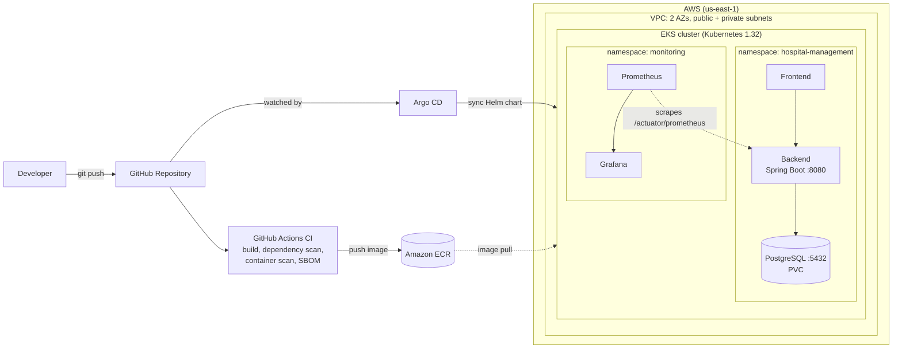

---

## Tech Stack

| Layer | Tools |
|---|---|
| Application | React (Vite), Spring Boot (Java), PostgreSQL |
| Containers | Docker, Amazon ECR |
| Infrastructure | Terraform (VPC, IAM, ECR, EKS modules), AWS EKS, EC2 managed nodes |
| CI | GitHub Actions (build, dependency scan/audit, container scan, SBOM) |
| CD / GitOps | Helm, Argo CD v3.5 |
| Security | Kubernetes NetworkPolicies, RBAC, IMDSv2 enforced on nodes, restricted EKS public endpoint CIDR |
| Observability | kube-prometheus-stack, Prometheus, Grafana, kube-state-metrics, node-exporter |

---

## Repository Structure

```
production-devsecops-platform/
├── app/
│   ├── backend/            # Spring Boot API + Dockerfile
│   └── frontend/           # React (Vite) UI + Dockerfile
├── argocd/                 # Argo CD Application manifest
├── docs/                   # Documentation and screenshots
├── evidence/               # Captured cluster baseline output
├── helm/hospital-management/
│   ├── Chart.yaml
│   ├── values.yaml
│   └── templates/          # backend, database, frontend
├── infrastructure/terraform/
│   ├── modules/            # vpc, iam, ecr, eks
│   └── environments/dev/   # main.tf, providers.tf, outputs.tf
├── kubernetes/
│   ├── base/ overlays/
│   └── security/           # network-policies.yaml, rbac.yaml
├── monitoring/
│   ├── grafana/dashboards/ # restarts, readiness, CPU, memory
│   └── prometheus/
├── scripts/
├── .github/workflows/ci.yml
└── docker-compose.yml      # local development
```

---

## 1. Infrastructure as Code (Terraform)

The `dev` environment composes four reusable modules: **VPC**, **IAM**, **ECR**, and **EKS**. The cluster runs Kubernetes 1.32 on a managed node group (`c7i-flex.large`, min 1 / max 2) placed in private subnets, and the public API endpoint is restricted to a specific CIDR.

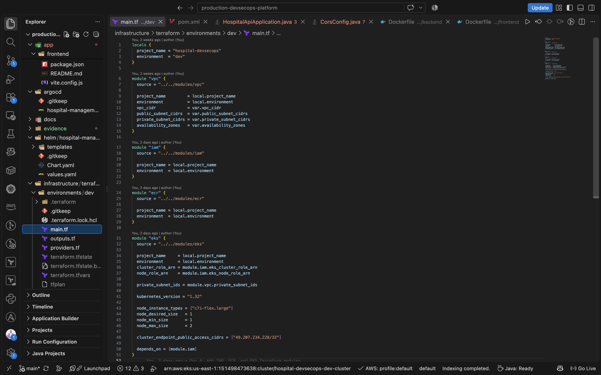

**Networking**: one VPC with two public and two private subnets across `us-east-1a` and `us-east-1b`, with separate public and private route tables.

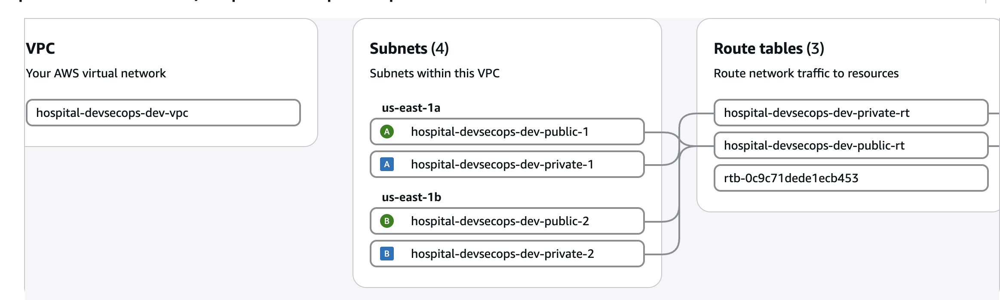

**EKS cluster**: active, with zero cluster health issues, zero node health issues, and zero capability issues.

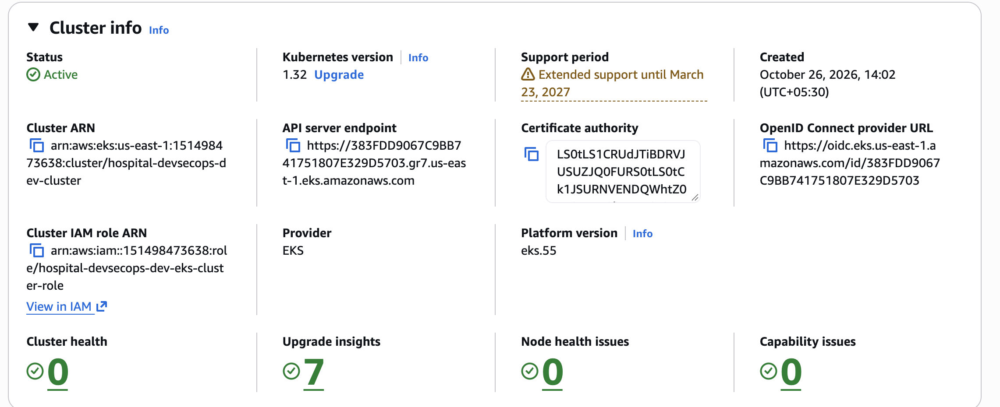

**Worker node**: running in a private subnet with 3/3 status checks passed and IMDSv2 required.

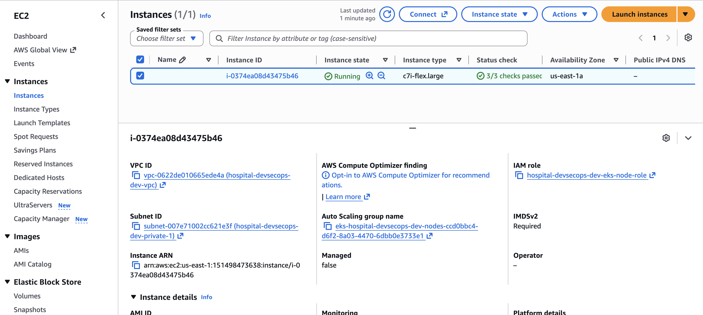

---

## 2. CI Pipeline (GitHub Actions)

`ci.yml` runs on every push with three jobs:

1. **Backend Build and Dependency Scan**
2. **Frontend Build and Dependency Audit**
3. **Container Scanning and SBOM**

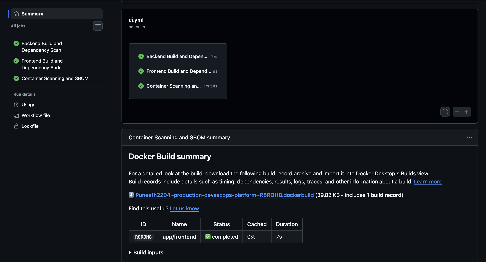

Images built by the pipeline are pushed to a private **Amazon ECR** repository with immutable, descriptive tags per change.

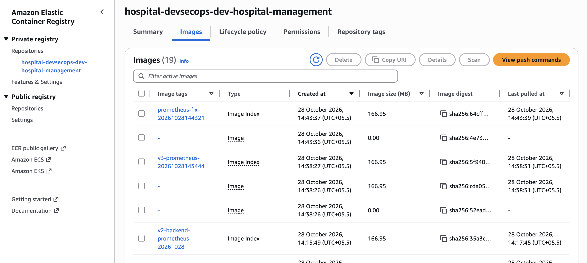

---

## 3. GitOps Delivery (Helm + Argo CD)

The `hospital-management` Helm chart deploys the backend, database, and frontend. Argo CD watches `main` with **auto-sync enabled**: the application shows **Synced** and **Healthy**, and each commit is reflected in the cluster as a new ReplicaSet revision (rolling update).

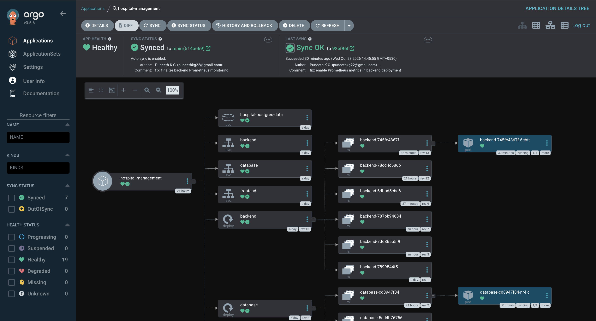

The running application, served from the cluster, reporting live data from the backend API:

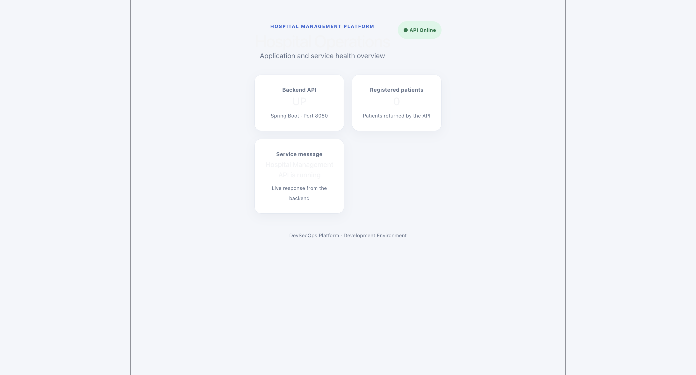

A scripted baseline capture confirms the deployed state end to end: Argo CD sync/health, pods, services, monitoring stack, and the Prometheus backend target reporting `up` with no scrape errors.

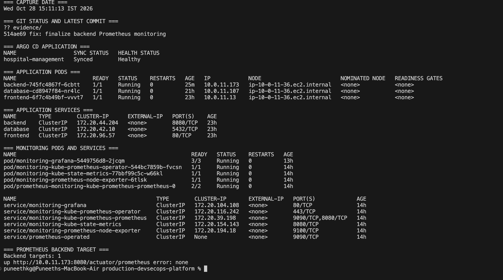

---

## 4. Kubernetes Security

### Network Policies
Frontend, backend, and database each have their own policy. Traffic is limited to the required paths only: frontend to backend on 8080, backend to database on 5432, Prometheus (from the `monitoring` namespace) to the backend metrics port, and DNS egress to `kube-dns`.

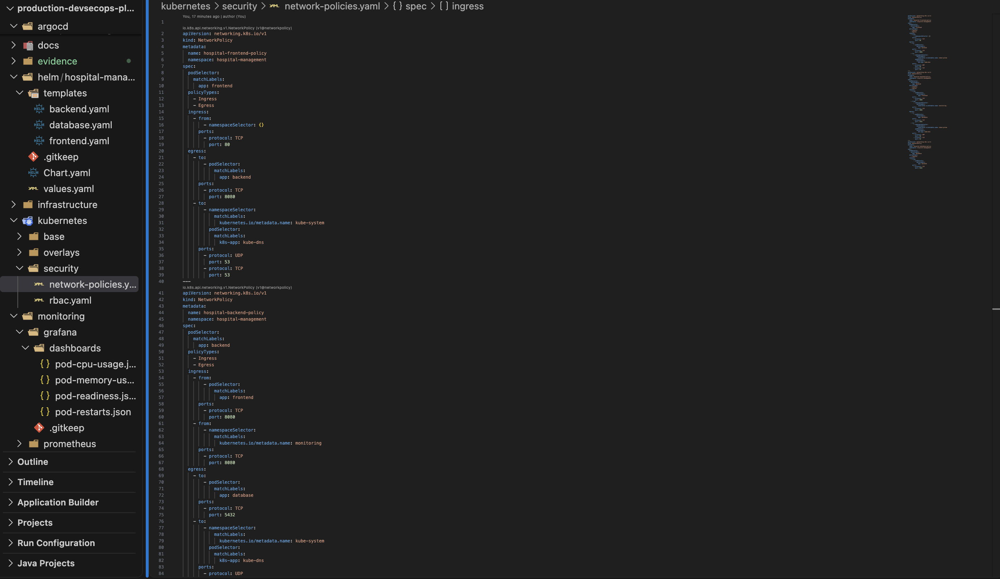

### RBAC
A dedicated `hospital-readonly` ServiceAccount, Role, and RoleBinding grant read-only (`get`, `list`, `watch`) access to pods, services, configmaps, deployments, and replicasets, following least privilege.

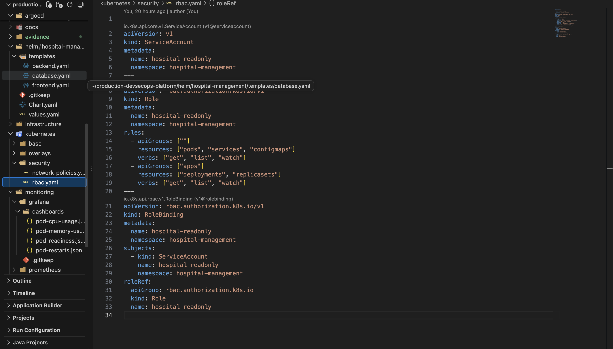

---

## 5. Observability (Prometheus + Grafana)

Prometheus (via kube-prometheus-stack) scrapes the Spring Boot actuator endpoint (`/actuator/prometheus`) on the backend pod. Dashboards are stored as JSON in `monitoring/grafana/dashboards/`.

| Container Restarts | Pod Readiness |
|---|---|
| 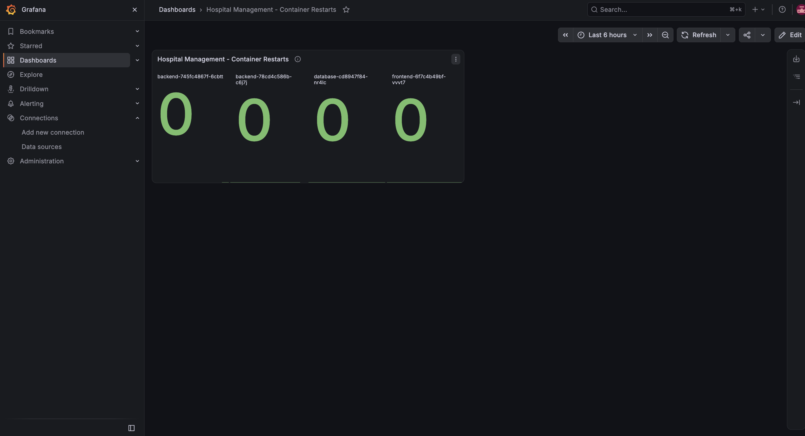 | 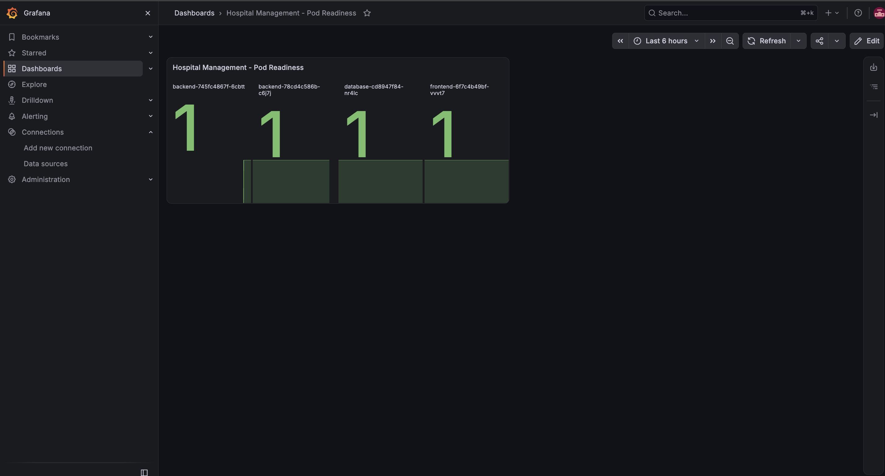 |

| Pod CPU Usage | Pod Memory Usage |
|---|---|
| 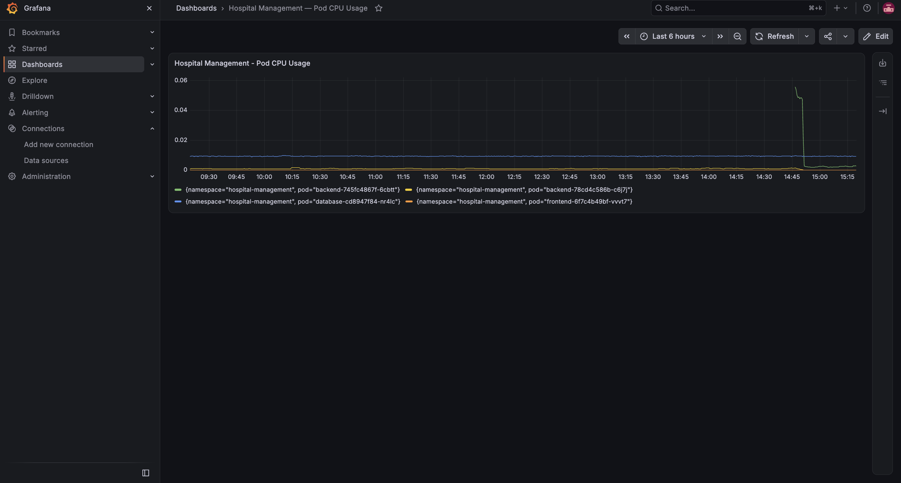 | 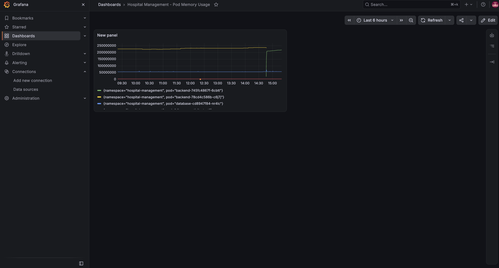 |

The CPU and memory graphs show the rollout of a new backend revision (the step change near 14:45): the new pod comes up, the old one is retired, and the other services remain stable. Restart counters stay at zero across all pods.

---

## Getting Started

> Adjust names, regions, and variables to your environment.

**Prerequisites**: AWS CLI (configured), Terraform, kubectl, Helm, Docker.

```bash
# 1. Clone
git clone https://github.com/Puneeth2204/production-devsecops-platform.git
cd production-devsecops-platform

# 2. Provision infrastructure
cd infrastructure/terraform/environments/dev
terraform init
terraform plan -out=tfplan
terraform apply tfplan

# 3. Connect kubectl to the cluster
aws eks update-kubeconfig --region us-east-1 --name hospital-devsecops-dev-cluster

# 4. Install Argo CD and register the application
kubectl create namespace argocd
kubectl apply -n argocd -f https://raw.githubusercontent.com/argoproj/argo-cd/stable/manifests/install.yaml
kubectl apply -f argocd/

# 5. Apply security policies
kubectl apply -f kubernetes/security/

# 6. Install monitoring
helm repo add prometheus-community https://prometheus-community.github.io/helm-charts
helm install monitoring prometheus-community/kube-prometheus-stack -n monitoring --create-namespace
```

**Local development**

```bash
docker compose up --build
```

**Tear down** (to avoid AWS charges)

```bash
cd infrastructure/terraform/environments/dev
terraform destroy
```

---

## What I Learned

- Designing modular Terraform for a reproducible EKS environment.
- Wiring security checks (dependency scanning, container scanning, SBOM) into CI.
- Running a pull-based GitOps workflow with Argo CD and Helm.
- Applying least-privilege controls with NetworkPolicies and RBAC.
- Debugging the full path from a Spring Boot actuator metric to a Prometheus target to a Grafana panel.

## Roadmap

- Centralized logging with Loki
- Horizontal Pod Autoscaling and load testing
- Ingress with TLS
- Image signing and policy enforcement in the cluster

---

## Author

**Puneeth K G** · [GitHub](https://github.com/Puneeth2204)
